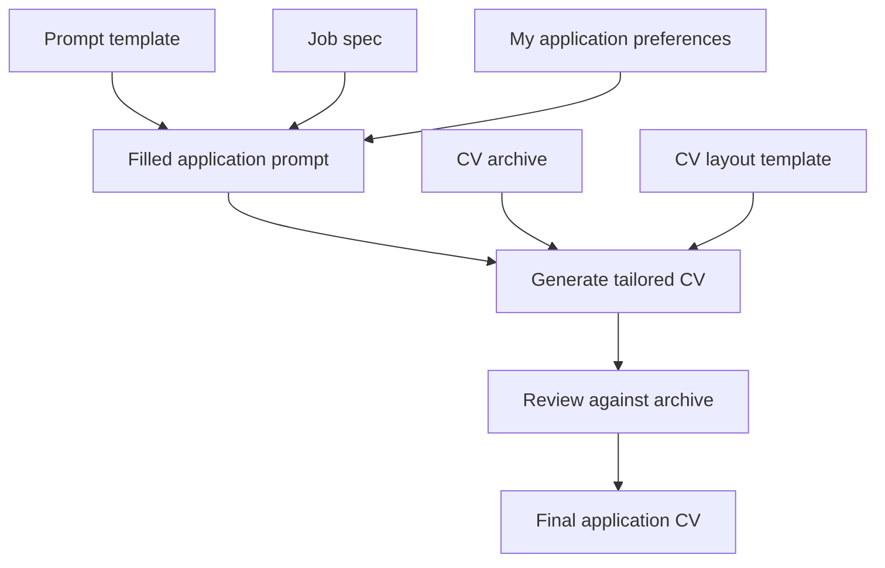

# CV generator

This repository keeps a master record of my work and uses it to produce a tailored CV for each application.

## Files

| File | Purpose |
| --- | --- |
| `cv-archive.md` | Source of truth for roles, projects, contributions, technologies, and outcomes. Update it from actual work records and firsthand knowledge. |
| `cv-generator-prompt-template.md` | Planned reusable instructions for tailoring a CV. The current `cv-generator-prompt.md` is an empty placeholder. Copy the template for each application and fill in the job spec and my preferences. |
| `cv-template.md` | Planned template for the generated CV. It defines section order, formatting, and guidance for filling each section. |
| `README.md` | Explains the repository and the generation workflow. |

The original `cv.md` seeded the archive during a one-time import. It is a local reference and stays out of Git.

## Application workflow

1. Copy the prompt template and add the job spec and application preferences, including any length, emphasis, or omission requests.
2. Run the filled prompt with the archive and the CV template. Use the job spec to prioritize relevant experience and the CV template to shape the output. Select, combine, omit, and rephrase archive entries while preserving dates, ownership, scope, and outcomes.
3. Check each claim against the archive before using the CV. If the review surfaces missing facts, verify them against actual project records or firsthand knowledge and update the archive at the source. Generated CVs are outputs of the pipeline.
